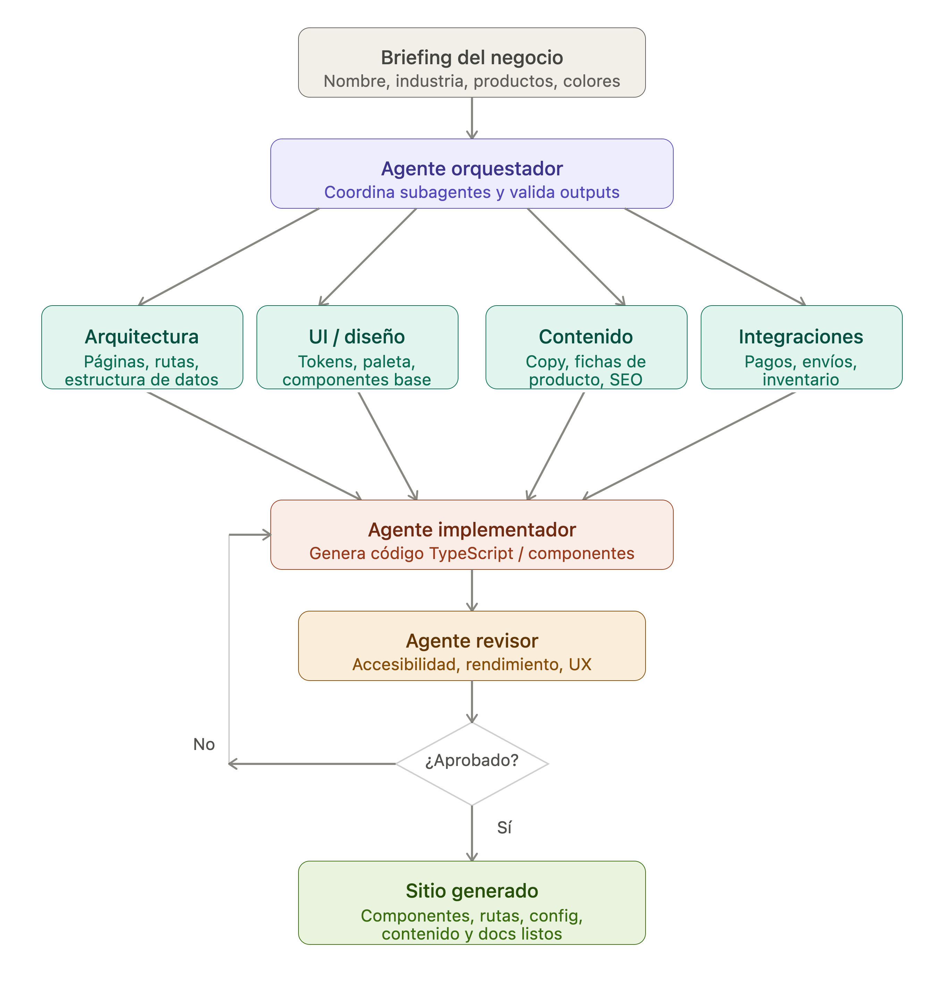

# Multi-Agent E-commerce Generator

Pipeline multi-agente sobre **Claude Code** que genera un sitio e-commerce completo (Next.js + TypeScript + Tailwind) a partir de un briefing de negocio. Un agente orquestador coordina seis subagentes especializados: cuatro diseñan el sitio en paralelo, uno lo implementa y otro lo audita en un loop de corrección hasta que el resultado se aprueba.

<p align="center">
  
</p>

## Cómo funciona

1. **Briefing:** el usuario entrega nombre, industria, tono, colores y productos, como JSON (`briefing.example.json`) o en la conversación.
2. **Specs en paralelo:** el orquestador lanza cuatro subagentes a la vez. Cada uno escribe solo su archivo en `/specs`.
3. **Aprobación humana:** el orquestador resume los specs y espera confirmación. Se pueden editar los archivos de `/specs` antes de aprobar.
4. **Implementación:** el implementador lee los specs, genera el sitio en `/site` y verifica que `npm run build` pase.
5. **Revisión:** el revisor audita build, lint, consistencia con los specs, accesibilidad y responsive, y escribe `reports/review.md` con veredicto `PASS` o `FAIL`.
6. **Loop de corrección:** si es `FAIL`, el implementador corrige solo lo señalado y se vuelve a revisar, hasta un máximo de 3 iteraciones antes de devolver el control al usuario.

## Agentes

| Agente | Responsabilidad | Output |
|---|---|---|
| `generar-ecommerce` (skill) | Orquesta el pipeline, pausa para aprobación y controla el loop | — |
| `ecommerce-architect` | Rutas, modelo de datos y estructura de carpetas | `specs/architecture.md` |
| `ecommerce-designer` | Paleta, tipografía y tokens de Tailwind | `specs/design-tokens.json` |
| `ecommerce-content` | Copy de marca, fichas de producto y SEO | `specs/content.md`, `specs/products.json` |
| `ecommerce-integrations` | Pagos, envíos e inventario (mock) | `specs/integrations.md` |
| `ecommerce-implementer` | Genera y corrige el sitio Next.js | `site/` |
| `ecommerce-reviewer` | Audita UI/UX, accesibilidad y rendimiento | `reports/review.md` |

## Decisiones de diseño

- **Specs como contrato entre agentes:** los agentes no se pasan mensajes, se comunican por archivos. Eso hace cada paso inspeccionable y editable por una persona.
- **Permisos mínimos por agente:** cada subagente solo tiene las herramientas que necesita y escribe solo en su carpeta. Los de spec no pueden tocar `/site` y el revisor no puede modificar código.
- **Human-in-the-loop:** el sitio no se implementa hasta que el usuario aprueba los specs.
- **Revisión con criterios objetivos:** el revisor solo marca `FAIL` por problemas accionables (build roto, ruta faltante, contraste, responsive), con archivo y corrección concreta, y no exige lo que los specs dejan explícitamente fuera de alcance.
- **Loop acotado:** máximo 3 iteraciones de corrección para evitar ciclos infinitos y costos sin control.
- **Alcance de MVP:** catálogo con búsqueda y filtros, carrito client-side y checkout mockeado, sin backend ni auth, con las integraciones especificadas para reemplazar el mock por Stripe u otro proveedor más adelante.

## Uso

Requiere [Claude Code](https://claude.com/claude-code) y Node.js 20+.

```bash
git clone https://github.com/carlosed7641/multi-agent-ecommerce.git
cd multi-agent-ecommerce
claude
```

Dentro de Claude Code:

```
/generar-ecommerce briefing.example.json
```

Cuando el revisor apruebe el sitio:

```bash
cd site
npm run dev
```

## Ejemplo incluido

`/specs` y `/reports` contienen la salida de una corrida real con el briefing de ejemplo, **Aroma Cafetería**, una tienda de café especial. El sitio generado tiene home, catálogo con búsqueda y filtro por categoría, ficha de producto, carrito, checkout mockeado y confirmación de pedido, y pasó la revisión en la primera iteración. `/site` no se versiona porque se regenera en cada corrida.

## Estructura

```
.claude/
  agents/                 Definición de los 6 subagentes
  skills/generar-ecommerce/  Skill orquestador del pipeline
docs/agent-flow.png       Diagrama del flujo
briefing.example.json     Briefing de ejemplo
specs/                    Specs generados (ejemplo: Aroma Cafetería)
reports/review.md         Reporte del revisor (ejemplo)
site/                     Sitio generado (no versionado)
```

## Stack

`Claude Code` · `Subagentes` · `Skills` · `Next.js` · `TypeScript` · `Tailwind CSS`

## Autor

**Carlos Castro Reales** · [LinkedIn](https://www.linkedin.com/in/carlos-castro-reales-53448b213)
